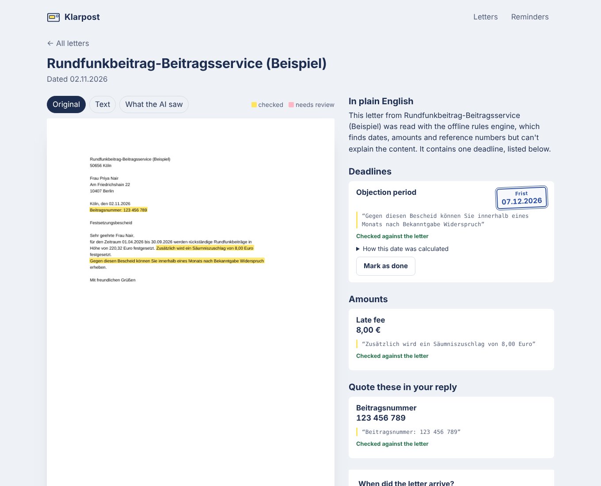
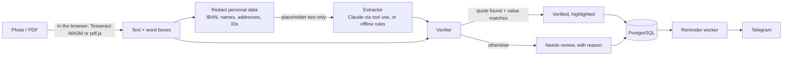
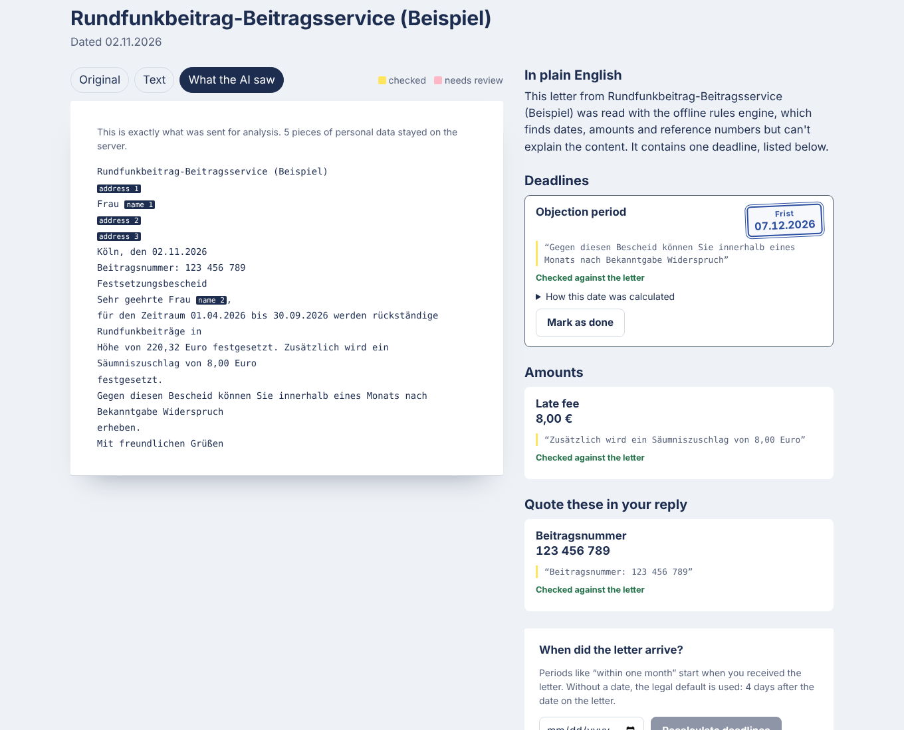

# Klarpost

**Understand German official letters, and check every deadline against the original.**

Upload a photo or PDF of a letter from the tax office, health insurer, Jobcenter or landlord. Klarpost explains it in plain English, extracts deadlines, amounts and reference numbers, **highlights exactly where each one appears on the letter**, and reminds you on Telegram before each deadline.



Plenty of apps already "explain German letters with AI". They all ask you to trust the model. Klarpost is built around the opposite idea: **an AI answer is only shown as fact if the code can prove it.**

## What makes it different

| | Typical AI letter app | Klarpost |
|---|---|---|
| Where did this deadline come from? | Trust us | Highlighted on the original page |
| Hallucinated date or amount | Shown as fact | Caught by verification, marked "needs review" |
| "Within one month of receipt" | The model guesses a date | Computed in code: 4-day delivery rule, month-end rule, weekends and each state's public holidays, with the steps shown |
| Your name, address, IBAN | Sent to the AI provider | Replaced with placeholders first; you can see exactly what was sent |
| How accurate is it? | Unknown | Measured on every commit by an evaluation suite |

## How it works



1. **Reading happens on the device.** Photos are read with Tesseract (WebAssembly) and PDFs with pdf.js in the browser. The server receives the text, the position of every word, and a downscaled page image.
2. **Redaction before the AI.** `src/core/redact.ts` replaces IBANs (validated with the ISO 13616 checksum), names, street addresses, postcodes, tax IDs, birth dates, phone numbers and emails with stable placeholders like `[IBAN_1]`. An offset map lets every position in the redacted text be mapped back to the original.
3. **Extraction with evidence.** The model must return structured output (forced tool use, validated with Zod) and give a verbatim **quote** for every claim. Without an API key, a deterministic rules engine takes its place.
4. **Verification.** `src/core/verify.ts` locates each quote in the letter (tolerating whitespace, case and typographic quotes) and checks that the claimed date, amount or reference really appears inside it. A separate rule-based sweep flags deadline-like dates the model didn't report. Only verified items, or items the user confirms, trigger reminders.
5. **Deadline maths.** `src/core/dates.ts` implements the deemed-delivery rule (§ 122 AO / § 41 VwVfG, 4 days since 2025), § 187/188 BGB period counting including month ends, and rolls deadlines off weekends and public holidays for all 16 federal states (Easter-based holidays computed).
6. **Reminders.** A worker sends Telegram messages 7, 3 and 1 days before (configurable) and on the day. Sending is idempotent: each reminder is claimed in `reminders_sent` (primary key on item + tier) before it's sent, and released if Telegram fails, so restarts and parallel workers never double-send. Messages have a "Mark as done" button.



## Accuracy

`npm run eval` runs both extractors over fictional sample letters in [`eval/letters.ts`](eval/letters.ts) (tax assessment, health insurance arrears, broadcasting fee, immigration appointment, Jobcenter, landlord, traffic fine, utility reminder, university, child benefit) and writes [`eval/REPORT.md`](eval/REPORT.md). Every letter is also re-run with lines wrapped mid-sentence, the way scans and PDFs arrive. Only **verified** items count as correct, because those are the ones a user would rely on. CI fails if any personal data would reach the AI.

| Metric (offline rules engine) | Clean text | Wrapped lines |
|---|---:|---:|
| Personal data leaked to the AI | 0 | 0 |
| Deadlines found | 82% | 82% |
| Deadlines correct (precision) | 100% | 100% |
| Amounts found / correct | 100% / 100% | 100% / 100% |

The two deadlines the rules engine misses ("Die Rückmeldefrist endet am …", "innerhalb der nächsten vier Wochen") were added on purpose: phrasing that patterns can't anticipate is what the AI extractor is for. With `ANTHROPIC_API_KEY` set, the report gains a column for the model so the two can be compared on the same letters.

The evaluation already paid for itself: it caught street names written as separate words ("Schönhauser Allee 150", "Am Friedrichshain 22") slipping through redaction, and amounts being missed when a sentence wrapped across lines.

## Tech stack

- **Next.js 16** (App Router, Route Handlers), **React 19**, **TypeScript** (strict)
- **PostgreSQL** with **Drizzle ORM** and versioned migrations; **PGlite** (Postgres compiled to WebAssembly) for zero-setup local development and fast isolated integration tests
- **Claude** via the Anthropic SDK with forced tool use; **Zod** for runtime validation of every request and every model response
- **Tesseract.js** and **pdf.js** for in-browser OCR and PDF text extraction
- **Telegram Bot API**: deep-link account linking with one-time tokens, webhook with secret-header verification, inline buttons
- **Vitest**: 55 tests, including database-backed integration tests for reminders and linking
- **Docker** multi-stage build (standalone web image + worker image), **docker compose**, **GitHub Actions** CI

## Run it locally

```bash
npm install
npm run dev            # http://localhost:3000, uses a local PGlite database in .data/
```

No accounts or keys are needed: the offline rules engine and the sample letters work out of the box. Optional extras in `.env` (see [`.env.example`](.env.example)):

- `ANTHROPIC_API_KEY`: switch to AI extraction and plain-English summaries.
- `TELEGRAM_BOT_TOKEN` and `TELEGRAM_BOT_USERNAME`: enable reminders. Locally, run `TELEGRAM_POLLING=1 npm run worker` so the worker fetches bot messages itself instead of needing a public webhook.

```bash
npm test               # unit + integration tests
npm run eval           # accuracy report
npm run typecheck
```

## Deploy

```bash
cp .env.example .env   # set SESSION_SECRET, POSTGRES_PASSWORD, TELEGRAM_*, APP_URL, ANTHROPIC_API_KEY
docker compose up -d --build
APP_URL=https://klarpost.example.org npx tsx scripts/set-webhook.ts
```

The web container listens on `127.0.0.1:3020`; put a reverse proxy with HTTPS in front, for example Caddy:

```
klarpost.example.org {
    reverse_proxy 127.0.0.1:3020
}
```

## API

| Method | Path | Purpose |
|---|---|---|
| `POST` | `/api/letters` | Analyse a letter (multipart: `document` JSON + page images, or `text`) |
| `GET` | `/api/letters` | List your letters |
| `GET` `PATCH` `DELETE` | `/api/letters/:id` | Read, set the date received (recalculates deadlines), delete |
| `GET` | `/api/letters/:id/pages/:n` | Page image |
| `PATCH` | `/api/items/:id` | Confirm, dismiss, or mark a deadline done |
| `POST` `GET` `DELETE` | `/api/telegram/link` | Create a one-time deep link, check status, unlink |
| `POST` | `/api/telegram/webhook` | Telegram updates (secret header required) |
| `POST` | `/api/cron/reminders` | Trigger a reminder run (`Authorization: Bearer $CRON_SECRET`) |
| `GET` | `/api/health` | Liveness and database check |

## Project layout

```
src/core/        pure, framework-free logic: redaction, extraction, verification, dates (fully unit-tested)
src/server/      database services, session, Telegram, reminders
src/app/         Next.js pages and API routes
src/client/      in-browser OCR and PDF reading
eval/            sample letters with answers, scoring
scripts/         reminder worker, webhook setup, evaluation runner
```

## Limitations and next steps

- Accounts are anonymous (a signed cookie per browser). Next: passkey sign-in so letters follow you across devices.
- The rate limiter is in-memory, which is fine for one instance; move it to Postgres or Redis to scale out.
- OCR quality depends on the photo. Handwriting isn't supported.
- Klarpost explains letters; it does not give legal or tax advice, and it deliberately doesn't draft formal objections (Widerspruch/Einspruch), which would count as legal services under German law.

All sample letters, names, addresses and IBANs in this repository are fictional.
